# 🎓 Öğrenci Geçer mi? — Sınav Başarısı Tahmini

Öğrencinin arka plan bilgilerine (cinsiyet, ailenin gelir durumu, ebeveyn eğitimi, hazırlık kursu, etnik grup) bakarak **sınavı geçip geçmeyeceğini** tahmin eden bir makine öğrenmesi projesi.

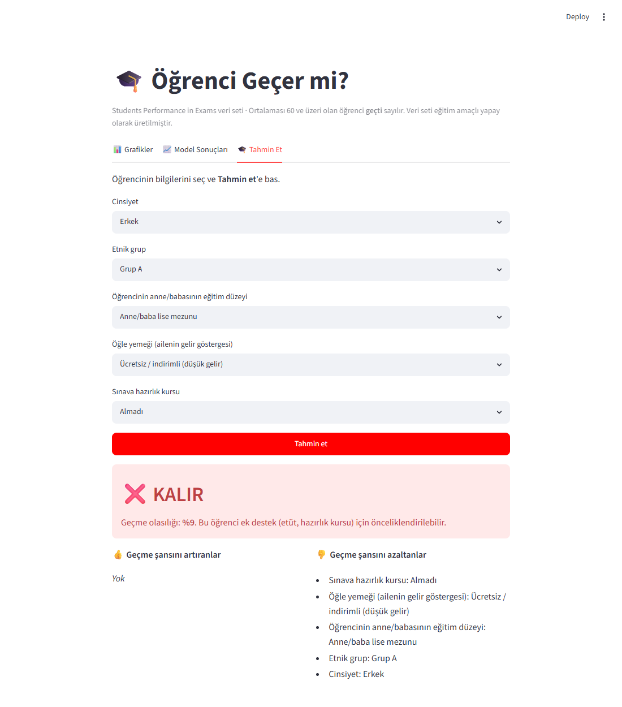

---

## 📌 Proje ne yapıyor?

Bu proje bir **ikili sınıflandırma** problemidir: Model her öğrenci için iki sonuçtan birini tahmin eder: **geçti (evet)** veya **kaldı (hayır)**.

### Veri seti

Kaggle'daki **[Students Performance in Exams](https://www.kaggle.com/datasets/spscientist/students-performance-in-exams)** veri seti kullanıldı: 1000 öğrenci, 8 sütun.

| Sütun | Açıklama |
|---|---|
| `gender` | Cinsiyet (kız / erkek) |
| `race/ethnicity` | Etnik grup (Grup A–E, gerçek isimleri gizlenmiş) |
| `parental level of education` | Öğrencinin **anne/babasının** eğitim düzeyi (öğrencinin kendisinin değil) |
| `lunch` | Öğle yemeği: standart (ücretli) veya ücretsiz/indirimli. ABD'de ücretsiz okul yemeği düşük gelirli ailelere verilir; bu sütun **ailenin gelir durumunu** gösterir |
| `test preparation course` | Sınava hazırlık kursunu tamamladı mı |
| `math score`, `reading score`, `writing score` | Matematik, okuma ve yazma notları (0–100) |

### "Geçti" nasıl belirlendi?

Veri setinde hazır bir geçti/kaldı bilgisi yok. Bu yüzden üç dersin ortalamasından hesaplandı:

> **Ortalama ≥ 60 → geçti**, **ortalama < 60 → kaldı**

**Neden 60?** Veri ABD okul sistemine göre hazırlanmıştır. ABD'de yaygın not sisteminde 60'ın altı **F**, yani "kaldı" anlamına gelir:

| Not | Harf | Anlamı |
|---|---|---|
| 90–100 | A | Geçti |
| 80–89 | B | Geçti |
| 70–79 | C | Geçti |
| 60–69 | D | Geçti (en düşük geçer not) |
| **0–59** | **F** | **Kaldı** |

### Model neye bakarak tahmin ediyor?

Model sınav notlarını **görmez**; sadece 5 arka plan bilgisine bakar: cinsiyet, etnik grup, ebeveyn eğitimi, öğle yemeği türü ve hazırlık kursu.

Sınav notları modele verilmedi, çünkü "geçti/kaldı" bilgisi zaten bu notlardan hesaplandı. Notlar modele verilseydi model cevabı önceden görmüş olurdu (**veri sızıntısı / data leakage**).

### Projenin adımları

1. **Veriyi tanıma:** Sütunların incelenmesi, sınıf dağılımı (kaç geçti, kaç kaldı)
2. **Veri temizleme:** Eksik değer ve tekrar eden satır kontrolü, gereksiz sütunların çıkarılması, kategorik verilerin sayıya çevrilmesi (one-hot encoding)
3. **Görselleştirme:** Her özelliğin geçme oranına etkisini gösteren 6 grafik ve yorumları
4. **Model:** %80 eğitim (train) / %20 test ayrımı; Logistic Regression, Decision Tree ve Random Forest
5. **Değerlendirme:** Accuracy, precision, recall, confusion matrix; modelin yanlış tahmin ettiği örneklerin incelenmesi

---

## 📁 Proje yapısı

```
ogrenci-gecti-gecmedi/
├── ogrenci_gecme_tahmini.ipynb   → Analizin tamamı: kod, grafikler, sonuçlar ve yorumlar
├── app.py                        → Streamlit arayüzü
├── data/
│   └── StudentsPerformance.csv   → Veri seti
├── images/                       → README'deki grafikler ve ekran görüntüleri
├── requirements.txt              → Gerekli Python kütüphaneleri
└── README.md
```

| | Notebook (`.ipynb`) | Uygulama (`app.py`) |
|---|---|---|
| Ne işe yarar? | Analizin adım adım anlatıldığı **rapor** | Tarayıcıda çalışan **etkileşimli uygulama** |
| Veri tanıma ve temizleme | ✅ | ❌ |
| 6 grafik ve yorumları | ✅ Detaylı yorum | ✅ Kısa yorum |
| Model sonuçları ve confusion matrix | ✅ | ✅ |
| Katsayı analizi ve hata analizi | ✅ | ❌ |
| Seçilen bir öğrenci için tahmin | ❌ | ✅ |

İkisi de modeli aynı veri ve aynı ayarlarla eğitir; sonuçları birebir aynıdır.

---

## ▶️ Nasıl çalıştırılır?

### 1. Projeyi indir

```bash
git clone https://github.com/aysegulkaratas274/ogrenci-gecti-gecmedi.git
cd ogrenci-gecti-gecmedi
```

### 2. Gerekli kütüphaneleri kur

```bash
pip install -r requirements.txt
```

### 3. Notebook'u aç

`ogrenci_gecme_tahmini.ipynb` dosyasını **VS Code** veya **Jupyter** ile aç. Çıktılar dosyaya kayıtlı olduğu için yeniden çalıştırmadan da tüm tablolar ve grafikler görünür. Ayrıca GitHub'da dosyaya tıklayarak tarayıcıda da görüntüleyebilirsin.

Notebook'u baştan çalıştırmak istersen: Jupyter'da **Run All** (VS Code'da **Run All**) seçeneğini kullan.

### 4. Streamlit uygulamasını başlat

```bash
streamlit run app.py
```

Tarayıcıda `http://localhost:8501` adresinde uygulama açılır. Kapatmak için terminalde **Ctrl + C**'ye bas.

> **Not:** Komutu proje klasöründeyken çalıştır; uygulama veriyi `data/` klasöründen okur.
> `streamlit` komutu bulunamazsa: `python -m streamlit run app.py`

---

## 📊 Sonuçlar

### Sınıf dağılımı

1000 öğrenciden **715'i geçti (%71.5)**, **285'i kaldı (%28.5)**. Sınıflar tam dengeli değil; geçenler yaklaşık 2.5 kat fazla.

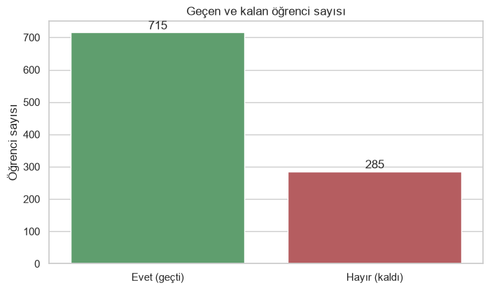

### Hangi özellikler geçmeyi etkiliyor?

| Özellik | Geçme oranı |
|---|---|
| **Öğle yemeği** | Standart (ücretli) **%79.8** — Ücretsiz/indirimli **%56.3** |
| **Hazırlık kursu** | Tamamladı **%83.2** — Almadı **%65.0** |
| **Ebeveyn eğitimi** | Lise ve altı **%61–64** — Lisans / yüksek lisans **%82–83** |
| **Cinsiyet** | Kız **%76.1** — Erkek **%66.6** |
| **Etnik grup** | Grup A **%55.1** — Grup E **%82.9** |

En büyük farkı yaratan iki özellik **öğle yemeği türü (ailenin gelir durumu)** ve **hazırlık kursu**.

<p>
  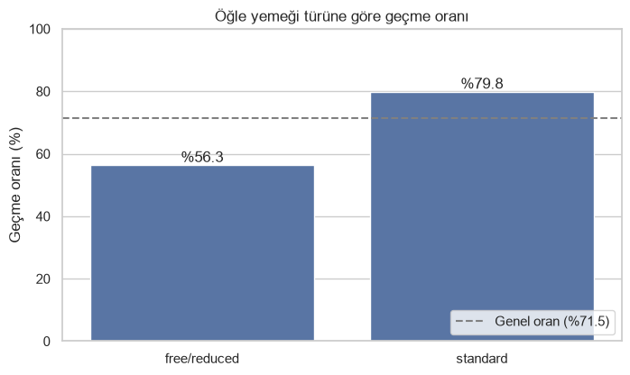
  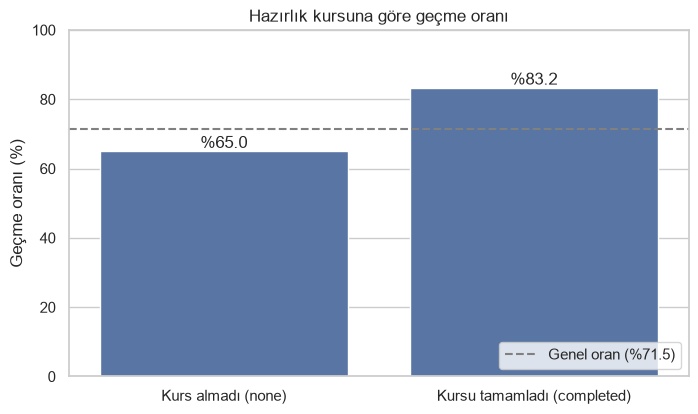
</p>
<p>
  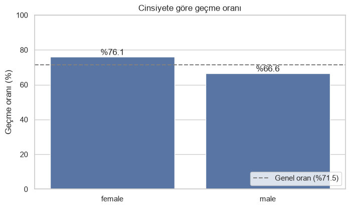
  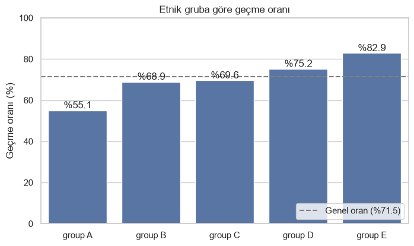
</p>

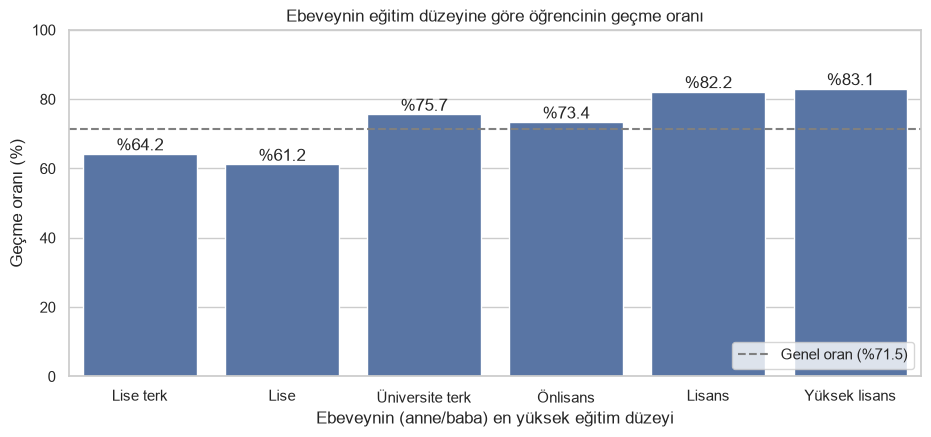

### Model sonuçları

Modeller, daha önce görmedikleri **200 öğrencilik test kümesinde** (143 geçen, 57 kalan) değerlendirildi.

| Model | Accuracy | Precision (geçti) | Recall (geçti) | Recall (kaldı) |
|---|---|---|---|---|
| **Logistic Regression** ⭐ | **0.630** | **0.795** | 0.650 | **0.579** |
| Decision Tree | 0.580 | 0.776 | 0.580 | **0.579** |
| Random Forest | 0.615 | 0.762 | **0.671** | 0.474 |

**En iyi model: Logistic Regression.** Accuracy'si en yüksek olan ve kalacak öğrencileri en iyi yakalayan model. Kalacak 57 öğrenciden 33'ünü doğru tespit ediyor.

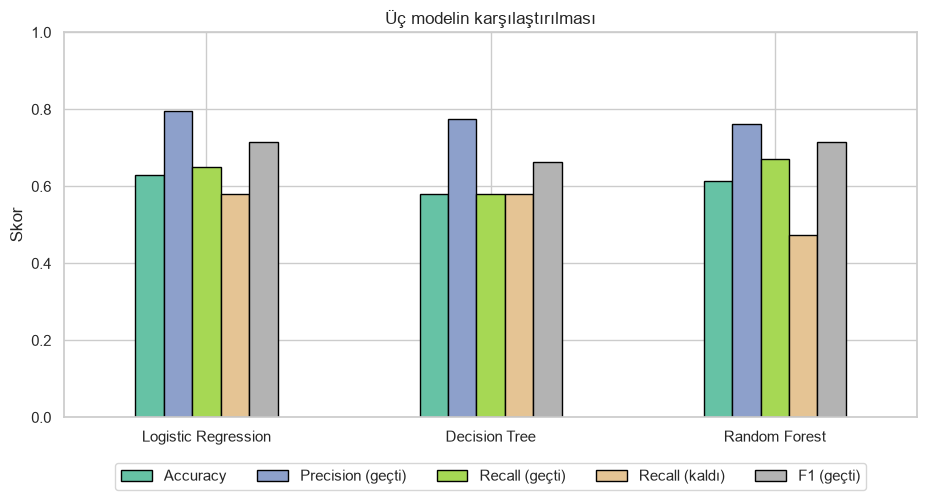

### Confusion matrix

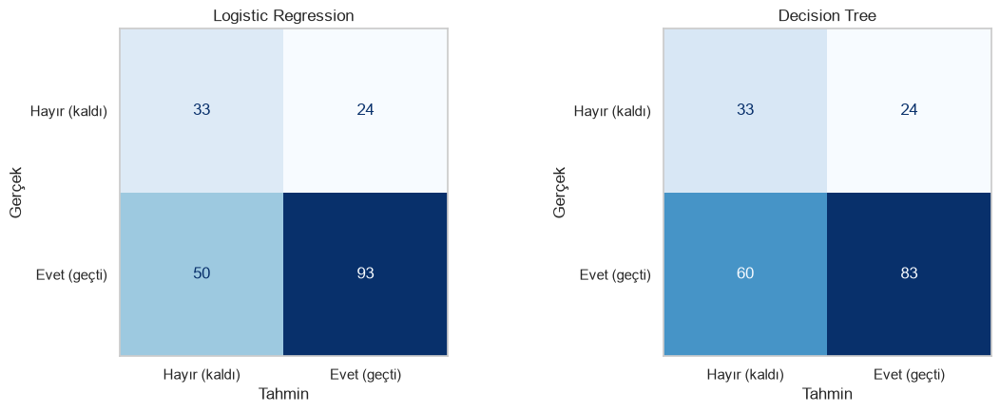

| Logistic Regression | Tahmin: Kalır | Tahmin: Geçer |
|---|---|---|
| **Gerçek: Kaldı** | 33 (doğru) | 24 (yanlış "evet") |
| **Gerçek: Geçti** | 50 (yanlış "hayır") | 93 (doğru) |

### Yanlış "evet" mi daha kötü, yanlış "hayır" mı?

- **Yanlış "evet":** Gerçekte kalacak bir öğrenciye model "geçer" der.
- **Yanlış "hayır":** Gerçekte geçecek bir öğrenciye model "kalır" der.

**Bu problemde yanlış "evet" daha kötüdür.** Böyle bir model, risk altındaki öğrencileri erken tespit edip destek (etüt, hazırlık kursu) sağlamak için kullanılır. Yanlış "evet" olduğunda yardıma ihtiyacı olan öğrenci gözden kaçar ve sınavda kalır. Yanlış "hayır" olduğunda ise geçecek bir öğrenci gereksiz yere ek desteğe yönlendirilir; bu öğrenciye zarar vermez.

Bu yüzden modeller `class_weight="balanced"` ayarıyla, kalacak öğrencileri yakalamaya öncelik verecek şekilde eğitildi:

| Logistic Regression | Accuracy | Kalanları yakalama |
|---|---|---|
| Ayar olmadan | 0.68 | 57 öğrenciden **12'si** |
| `class_weight="balanced"` | 0.63 | 57 öğrenciden **33'ü** |

Accuracy'den 5 puan feda edilerek yakalanan riskli öğrenci sayısı 12'den 33'e çıkarıldı.

### Hangi özellik geçme şansını ne kadar etkiliyor?

Logistic Regression katsayıları (yeşil: şansı artırır, kırmızı: şansı azaltır):

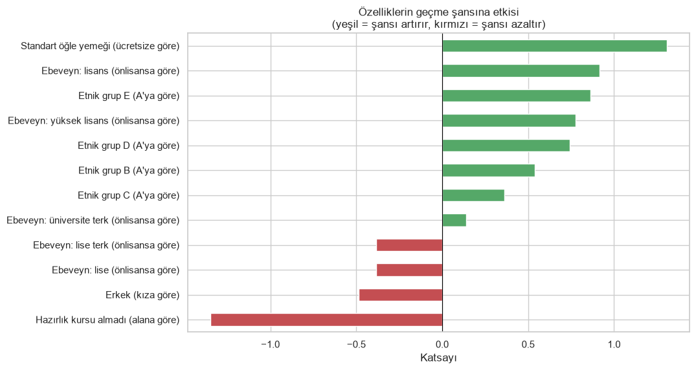

- **Standart öğle yemeği:** Ücretsiz/indirimli yemeğe göre geçme şansı (odds) yaklaşık **3.7 kat** fazla.
- **Hazırlık kursu almamak:** Kursu alana göre geçme şansı yaklaşık **%74 daha düşük**.
- **Ebeveynin lisans / yüksek lisans mezunu olması:** Önlisans mezunu ebeveyne göre şans **2 katın üzerinde**.
- **Erkek olmak:** Kız öğrenciye göre geçme şansı yaklaşık **%38 daha düşük**.

### Model neden yanılıyor?

Notebook'un 6.2 bölümünde modelin en emin olduğu halde yanıldığı öğrenciler incelendi. Yanlış tahmin edilen öğrenciler, profilinin tersine sonuç alan öğrenciler: Örneğin bütün olumsuz özellikleri taşıdığı için model %9 geçme olasılığı verdiği halde 78 ortalamayla geçen bir öğrenci var. Model sadece arka plan bilgisini gördüğü için öğrencinin ne kadar çalıştığını bilemez; bilgileri birebir aynı olan iki öğrenciye aynı tahmini verir.

---

## 🖥️ Ekran görüntüleri

Streamlit uygulaması üç sekmeden oluşur.

### 📊 Grafikler

Notebook'taki 6 grafik ve kısa yorumları.

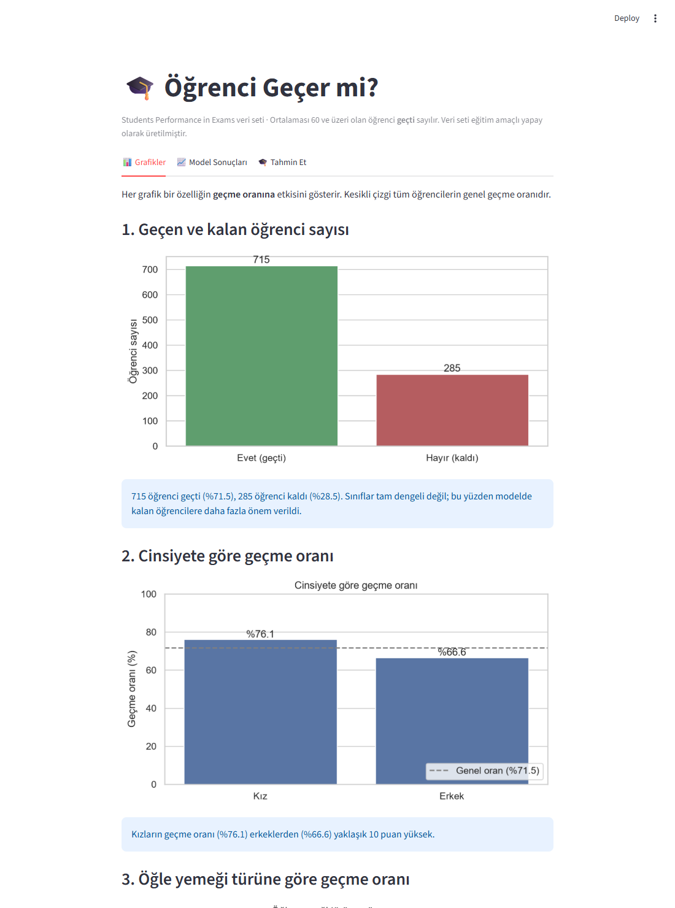

### 📈 Model Sonuçları

Üç modelin karşılaştırma tablosu (en iyi değerler yeşil) ve seçilen modelin confusion matrix'i.

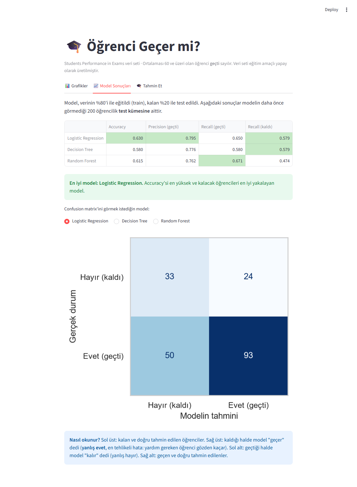

### 🎓 Tahmin Et

Öğrencinin bilgileri seçilir; uygulama **GEÇER / KALIR** sonucunu, geçme olasılığını ve sonucu hangi bilgilerin olumlu ya da olumsuz etkilediğini gösterir.


---

## ❓ Sık sorulan sorular

**Herkese "geçer" diyen bir model bile %71.5 accuracy alır. Bu model neden %63?**
O model kalacak öğrencilerin hiçbirini bulamaz. Bu model ise 57 riskli öğrenciden 33'ünü buluyor. Amaç riskli öğrenciyi bulmak olduğu için accuracy'den bir miktar feda edildi.

**Accuracy neden daha yüksek değil?**
Model öğrencinin çalışma süresini, devamsızlığını, önceki notlarını bilmiyor; sadece 5 arka plan bilgisine bakıyor. Aynı arka plana sahip iki öğrenciden biri geçip diğeri kalabiliyor. Daha iyi bir tahmin için bu tür ek bilgilere ihtiyaç var.

**Neden en karmaşık model (Random Forest) en iyi sonucu vermedi?**
Elimizde sadece 5 kategorik özellik var ve etkileri büyük ölçüde toplanabilir (kurs + yemek + ebeveyn eğitimi...). Bu tür basit bir ilişkiyi doğrusal bir model olan Logistic Regression daha iyi yakalıyor.

---

## ⚠️ Verinin sınırları

Bu veri seti gerçek öğrencilerden toplanmamıştır. Royce Kimmons'ın veri bilimi öğrencileri için hazırladığı bir veri üreticisiyle **yapay (kurgusal) olarak oluşturulmuştur** ([roycekimmons.com/tools/generated_data/exams](http://roycekimmons.com/tools/generated_data/exams)). Bu nedenle sonuçlar gerçek öğrenciler için genellenemez. Proje, bir sınıflandırma probleminin baştan sona nasıl kurulduğunu göstermek amacıyla yapılmıştır.

---

## 🛠️ Kullanılan kütüphaneler

| Kütüphane | Kullanım amacı |
|---|---|
| **pandas** | Veriyi okuma ve tablo işlemleri |
| **numpy** | Sayısal hesaplamalar |
| **matplotlib / seaborn** | Grafikler |
| **scikit-learn** | Modeller (Logistic Regression, Decision Tree, Random Forest) ve başarı ölçümleri |
| **streamlit** | Tarayıcıda çalışan arayüz |
